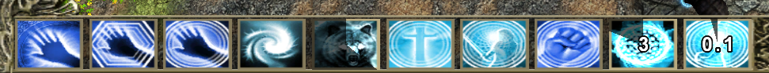

### Mod adds a visual cooldown after casting a spell, similar to how it appears in SF2, if the remaining time until a spell can be cast is less than 10 seconds, a countdown is displayed. Upon launch, the mod creates a .txt file where you can edit the settings.
