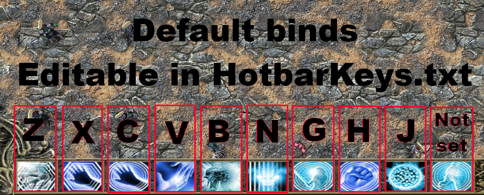
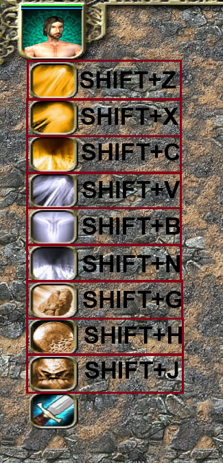

### Spells on the bottom hotbar are bound to specific keys for example, press 'X' to cast the spell in the second slot. Spells on the top-left hotbar require holding the SHIFT key for example, press SHIFT+C to cast the spell in the third slot. The images below shows the default config, which can be customized in a .txt file that is generated first time you launch the game.

