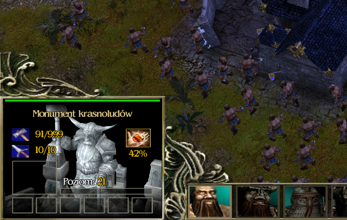

### Mod allows you to adjust the maximum number of workers you can have, based on the living quarters you have built. Upon launching the game for the first time, a .txt file is generated where you can modify these settings.
## Default config:
### NoHeadquarters=20
### SmallHeadquarters=30
### MediumHeadquarters=40
### LargeHeadquarters=50
