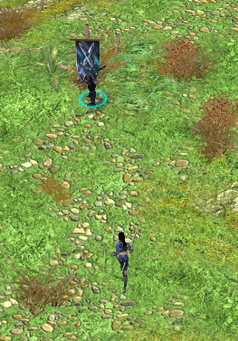

### With a monument selected, you can place a flag on any of your units by right-clicking on them, units created at the monument will then move toward that unit. This works the same way as in SpellForce 3.

### Mod created by Somka
