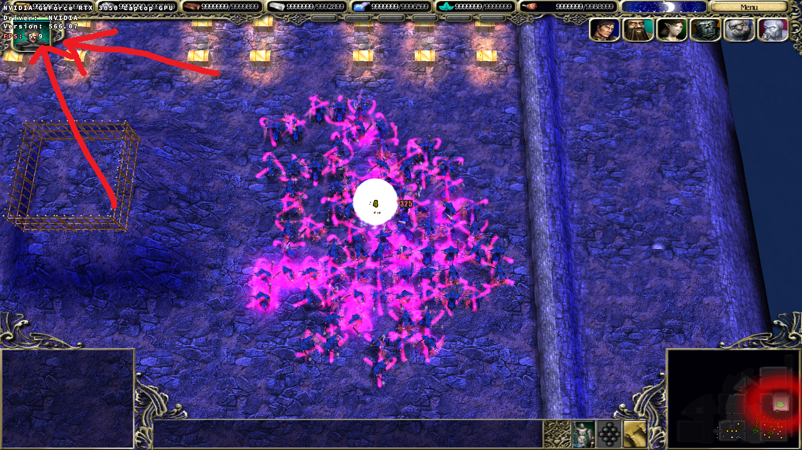
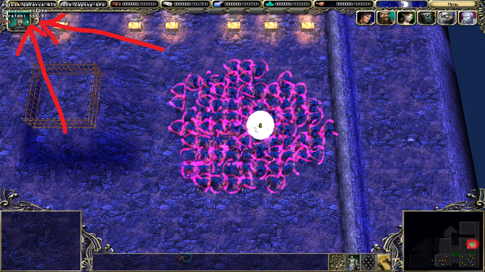

### Mod reduces main thread usage by spellcasting units thirteenfold. You get much higher FPS in the game.
## How to install mod:
### Download and add one of .asi, .sfm, or .bat file, I recommend downloading the .asi or .sfm version, as they offer slightly better optimization than .bat version. If you want use .bat, place it in the game's main folder (where SpellForce.exe is located) and run it like any regular program. 
### Note: .bat only works if the game's .exe is named SpellForce, which is the default name.
### You can also create a shortcut with SpellForce.exe e.g. on the desktop, then right-click the new shortcut --> Properties, in the "Target" field, add a space and `-nologfile` at the end, after the closing quote.
### Before without this mod (4-7 FPS)

### After adding this mod (69-75 FPS)

### Mod craeted by Somka